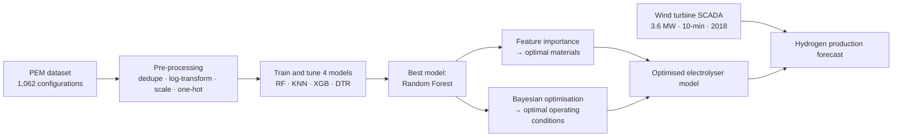
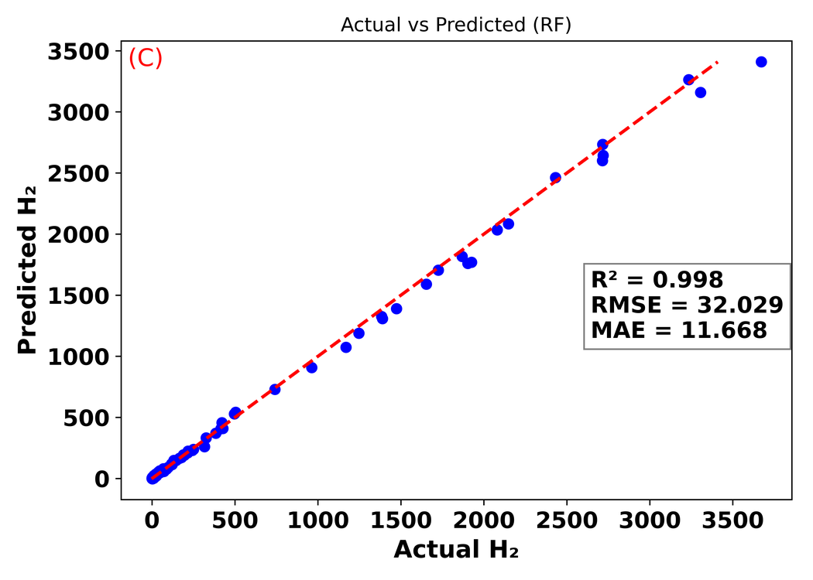
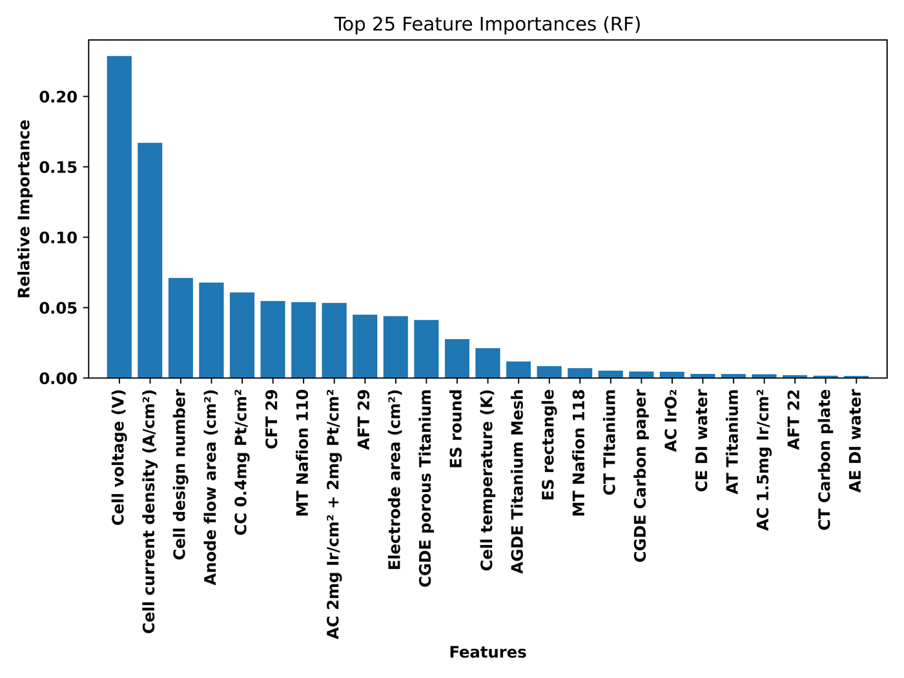
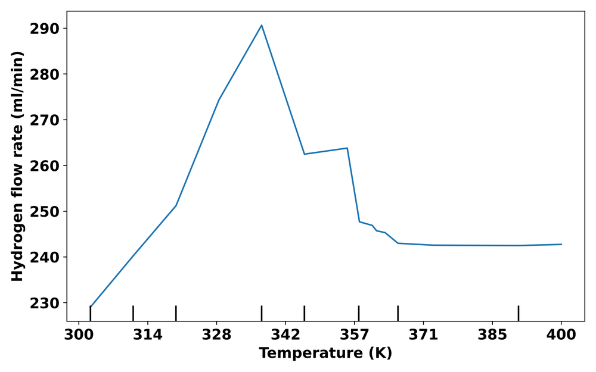
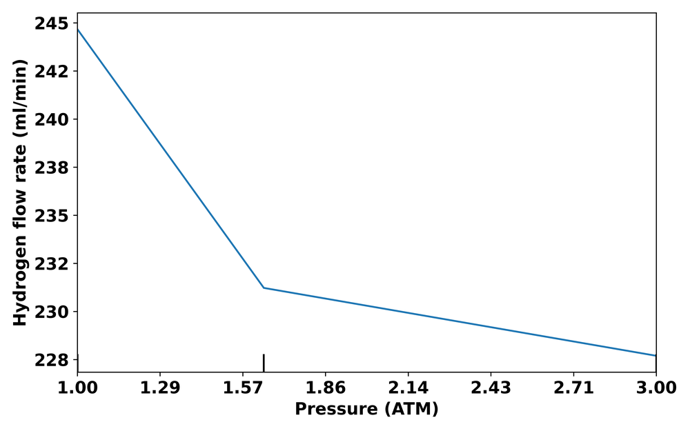
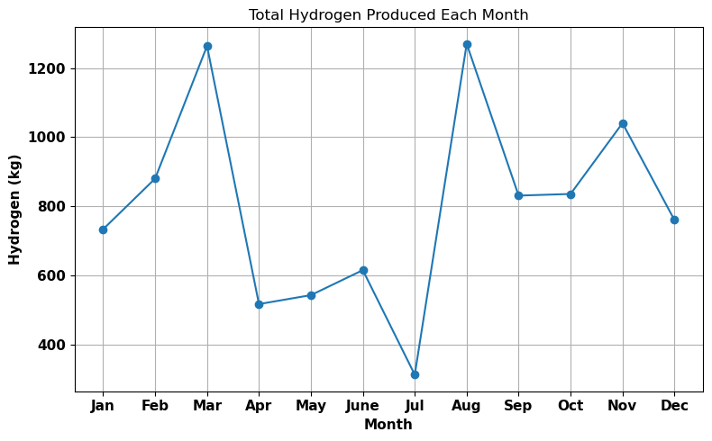

# Green Hydrogen from Wind: ML-Optimised PEM Electrolyser Design

**MEng Mechanical Engineering, Individual Project (FEEG3003): University of Southampton, 2023–24**
Awarded a **First (70%)** · Supervisor: Dr Ranga Dinesh Kahanda Koralage

This project uses machine learning to find the design and operating conditions that maximise hydrogen output from a **proton exchange membrane (PEM) electrolyser**. It then couples the optimised design with a year of real wind turbine data to forecast how much green hydrogen it could produce.

📄 [Full dissertation (PDF)](report/dissertation.pdf) · 🖼️ [Project poster (PDF)](report/poster.pdf)

---

## Highlights

- **Compared four regression models** (Random Forest, K-Nearest Neighbours, XGBoost, Decision Tree) for predicting hydrogen flow rate from 15 design and operating parameters. **Random Forest was the most accurate (R² = 0.998).**
- **Found the parameters that matter most:** cell voltage, current density and number of cells ranked highly across all models.
- **Optimised the electrolyser:** materials were selected from the feature-importance analysis and operating conditions from **Bayesian optimisation**. The optimised design predicts **4,200 ml/min** of hydrogen.
- **Forecast green hydrogen production:** the optimised model was driven by a year of 10-minute SCADA data from a **3.6 MW wind turbine** (Yalova, Turkey) and forecast **≈10 tonnes of hydrogen over 2018**.

## Pipeline



## Results

### 1. Model comparison

Hyperparameters were tuned with randomised search and 5-fold cross-validation. Scores below are on a held-out 20% test set.

| Model | R² | RMSE (ml/min) | MAE (ml/min) |
|---|---|---|---|
| **Random Forest** | **0.998** | **32.03** | **11.67** |
| K-Nearest Neighbours | 0.995 | 44.25 | 13.83 |
| XGBoost | 0.993 | 54.60 | 14.89 |
| Decision Tree | 0.985 | 80.72 | 29.52 |

<p align="center"></p>

### 2. What drives hydrogen production?

Cell voltage and current density control the reaction kinetics, consistent with Faraday's law of electrolysis. Together they account for about 40% of the Random Forest's feature importance, followed by the number of cells and the flow and electrode areas.

<p align="center"></p>

<sub>AT/CT = anode/cathode type · AGDE/CGDE = anode/cathode gas diffusion electrode · AC/CC = anode/cathode catalyst · MT = membrane type · AE/CE = anolyte/catholyte · AFT/CFT = anode/cathode flow-field pattern · ES = electrode shape</sub>

### 3. Optimal electrolyser design

| Design (from feature importance) | | Operating conditions (from Bayesian optimisation) | |
|---|---|---|---|
| Anode / cathode | Titanium | Number of cells | 10 |
| Anode GDE | Titanium mesh | Cell temperature | 337 K |
| Cathode GDE | Porous titanium | Cell voltage | 19 V |
| Membrane | Nafion 110 | Current density | 2 A/cm² |
| Cathode catalyst | 0.4 mg Pt/cm² | Electrode area | 80.9 cm² |
| Anode catalyst | 2 mg Pt/cm² + 2 mg IrO₂/cm² | Anode/cathode flow area | 50 cm² |
| Anolyte / catholyte | Deionised water | Pressure | 1 atm |
| Electrode shape / flow field | Round / pattern 29 | **Predicted H₂ flow rate** | **4,200 ml/min** |

The selected materials match those of a previous study on the same dataset ([Yang et al., 2023](https://doi.org/10.1016/j.energy.2022.126135)) at its largest design point (3,000 ml/min). Titanium's corrosion resistance and Nafion's durability at high current density suit the harsh acidic environment inside a PEM cell.

Partial dependence plots show an **optimal temperature window of about 337 K**. Above about 356 K, hydrogen output drops, consistent with membrane dehydration and degradation. Output also falls as pressure rises above 1 atm.

<p align="center">
  
  
</p>

### 4. Forecasting hydrogen from wind power

The turbine's active power output (50,530 readings at 10-minute intervals across 2018) was split across a bank of optimised electrolysers. Each unit runs at full capacity before excess power passes to the next. The setup models an **off-grid, directly coupled** system with no battery storage.

<p align="center"></p>

Production follows the wind closely. It peaks in **March and August**, dips to its lowest in **July**, and totals **≈10 tonnes** for the year. The forecast assumes ideal energy transfer and ignores compression and other system losses.

## Repository structure

```
├── data/
│   ├── pem_electrolyser_dataset.csv      # 1,062 PEM configurations, 26 variables
│   └── wind_turbine_scada_2018.csv       # Yalova wind farm SCADA data, 10-min, 2018
├── notebooks/
│   ├── 01_exploratory_data_analysis.ipynb
│   ├── 02_model_comparison.ipynb           # RF / KNN / XGB / DTR training, tuning, feature importance
│   ├── 03_numerical_model_partial_dependence.ipynb
│   ├── 04_bayesian_optimisation.ipynb      # optimal operating conditions (scikit-optimize)
│   └── 05_hydrogen_production_forecast.ipynb
├── results/
│   └── hydrogen_result.csv               # simulated H₂ (ml) per 10-min interval
├── figures/                              # figures used in this README
└── report/
    ├── dissertation.pdf
    └── poster.pdf
```

## Running the notebooks

The notebooks are saved with their outputs, so you can browse every result and plot on GitHub without running anything. To re-run them:

```bash
pip install -r requirements.txt
jupyter lab
```

- Open the notebooks from inside `notebooks/`. Data paths are relative to that folder.
- Run `03` before `04`: the Bayesian optimisation loads the model and scaler that `03` saves.
- The wind simulation loop in `05` is commented out because it is slow. Its output is provided in `results/hydrogen_result.csv`.
- The project was originally run on Python 3.8 (2024).

## Data sources

- **PEM electrolyser dataset:** compiled by R. Yang, A. Mohamed and K. Kim, *"Optimal design and flow-field pattern selection of proton exchange membrane electrolyzers using artificial intelligence"*, Energy 264 (2023) 126135. [doi:10.1016/j.energy.2022.126135](https://doi.org/10.1016/j.energy.2022.126135)
- **Wind turbine data:** [Wind Turbine SCADA Dataset](https://www.kaggle.com/datasets/berkerisen/wind-turbine-scada-dataset) (Kaggle), from a turbine at the Yalova wind farm, Turkey.

## Limitations and future work

- The PEM dataset is small and lab-scale. Repeating the study with megawatt-scale data and more advanced models (e.g. neural networks) would strengthen the conclusions.
- The hydrogen forecast simplifies real operation: there is no energy storage and no compression energy, and losses are ignored.
- Possible extensions include forecasting wind or solar input with ML, comparing sites to find the best locations for green hydrogen production, and building and testing the optimal design experimentally.

## Tools

Python · pandas · NumPy · scikit-learn · XGBoost · scikit-optimize · Matplotlib · seaborn · Jupyter

---

*Haseeb Mahmood, MEng Mechanical Engineering, University of Southampton*
